# 🚘 EuroCars

A modern European automotive marketplace designed to simplify
buying and selling vehicles across Europe.

[](https://eurocars-gray.vercel.app)

## 🛠️ Tech Stack


## 📖 Overview

EuroCars is a full-stack automotive marketplace featuring
vehicle discovery, listing management, user accounts,
and an administrative dashboard.

The platform combines a premium automotive design with
a modern server-side architecture and cloud infrastructure.

## ✨ Features

### 🚗 Marketplace

- Vehicle catalog
- Advanced search and filtering
- Detailed vehicle specifications
- Vehicle photo galleries
- Favorites
- Responsive design

### 👤 User Account

- User registration and authentication
- Persistent sessions
- Profile management
- Avatar management
- Personal vehicle listings
- Favorites management

### 📝 Listing Management

- Multi-step listing creation wizard
- Multiple vehicle photos
- Vehicle specifications and equipment
- Listing editing
- Draft management
- Listing moderation
- Listing archiving

### 🛡️ Administration

- Administrative dashboard
- Marketplace analytics
- User management
- Vehicle listing management
- Dealership management
- Listing moderation
- Audit logs
- System health monitoring

### 🔒 Security

- Secure password hashing
- HTTP-only session cookies
- Role-based access control
- Server-side validation
- Rate limiting
- Parameterized SQL queries
- Request origin validation

## 🏗️ Architecture

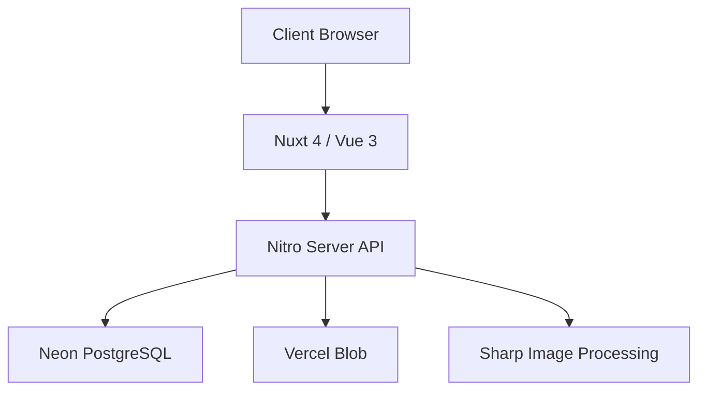

## ☁️ Infrastructure

| Service | Purpose |
|---------|---------|
| Vercel | Application hosting |
| Nitro | Backend API |
| Neon | PostgreSQL database |
| Vercel Blob | Cloud image storage |
| Sharp | Image optimization |


## 📸 Screenshots

<details>
<summary>🏠 Homepage</summary>

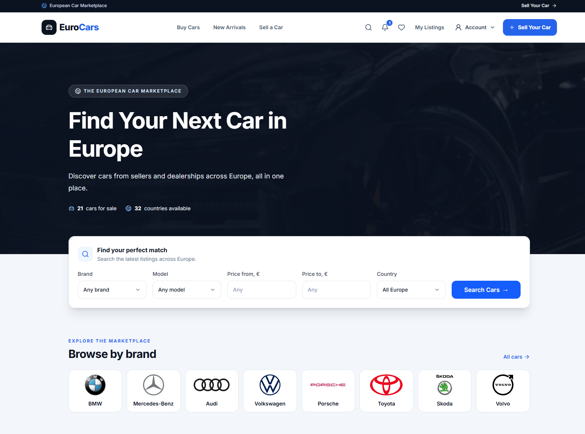
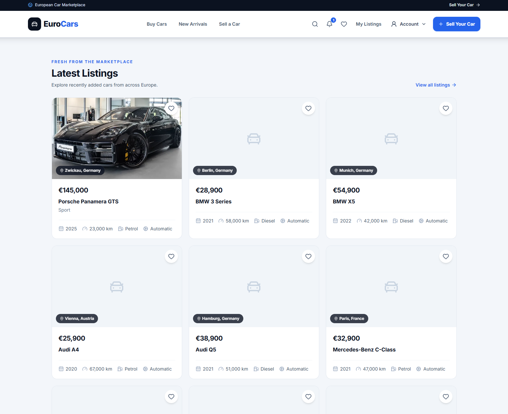

</details>

<details>
<summary>🚗 Vehicle Catalog</summary>

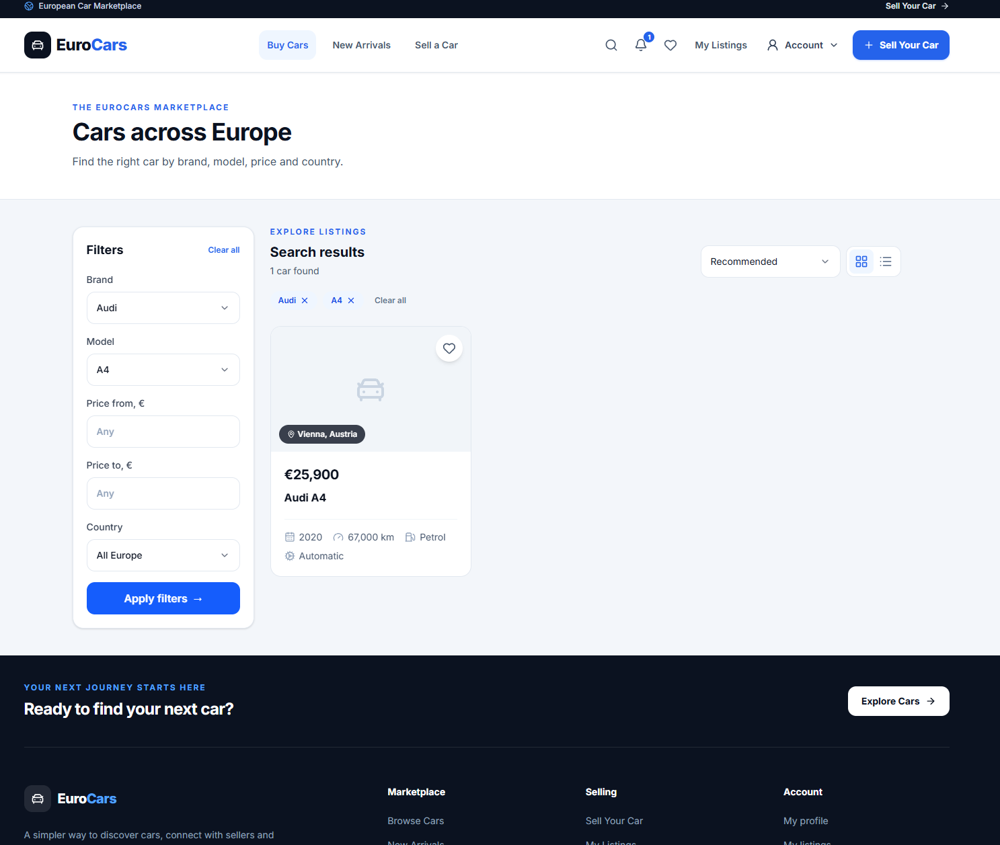

</details>

<details>
<summary>📝 Sell Your Car — Listing Wizard</summary>

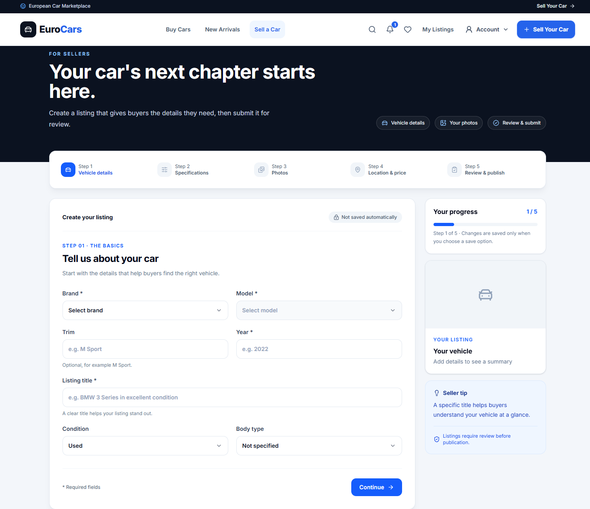
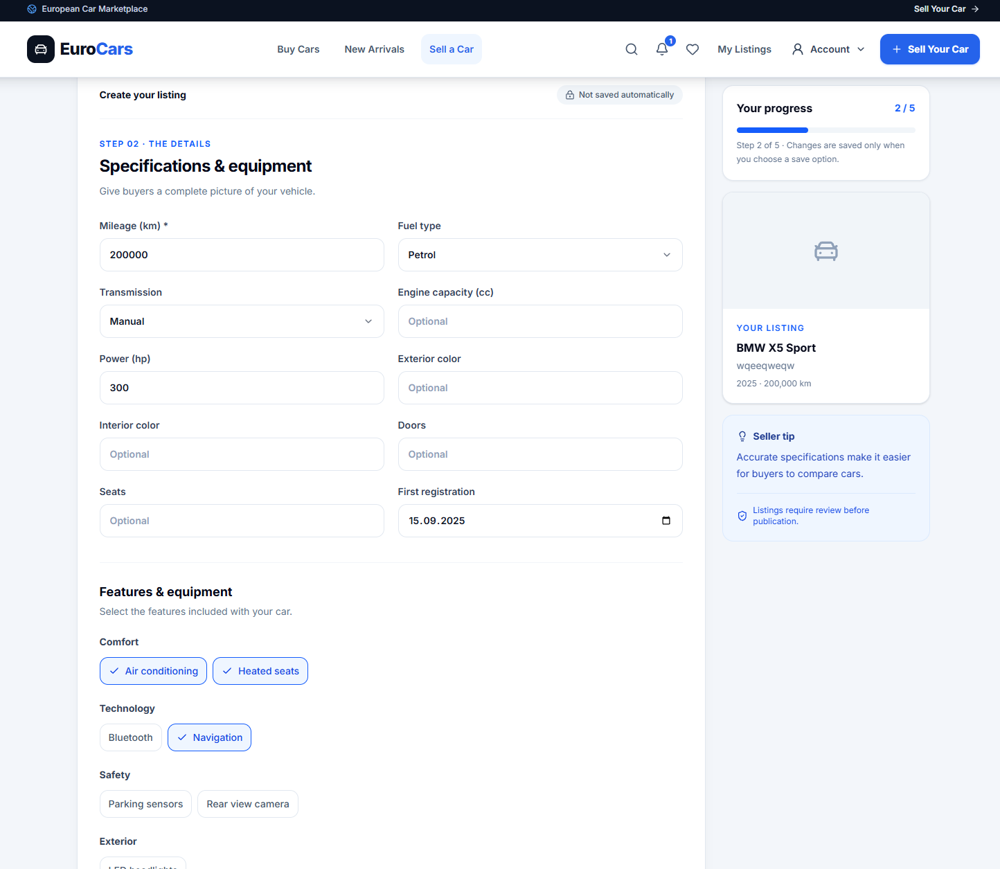
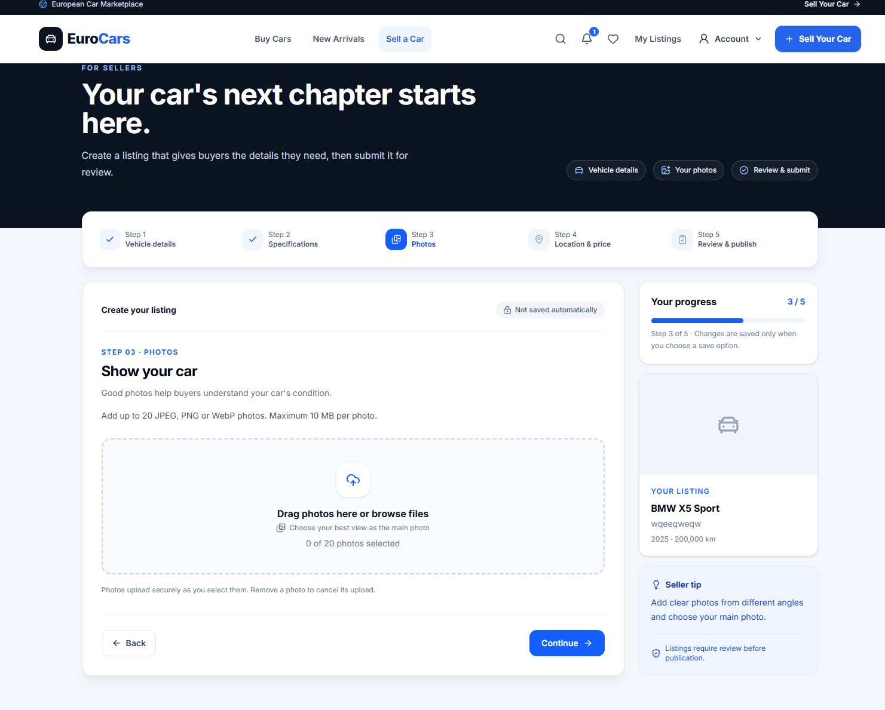
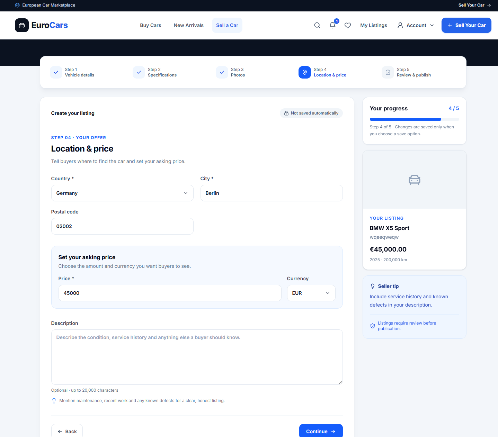
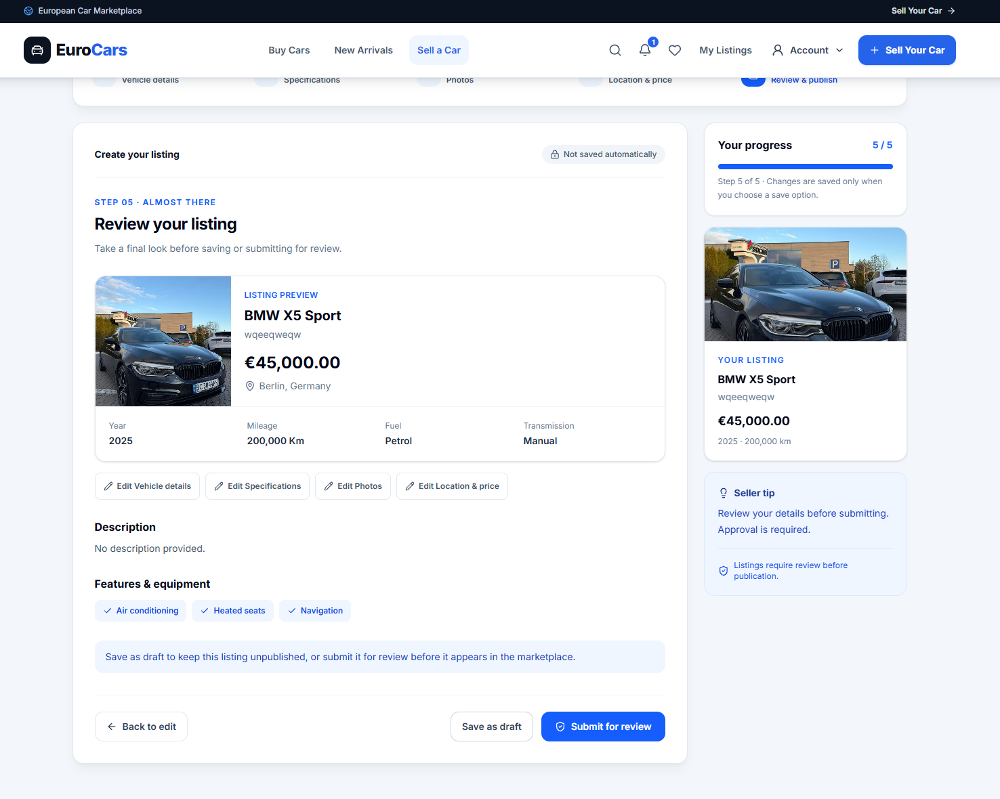

</details>

<details>
<summary>👤 My Listings</summary>

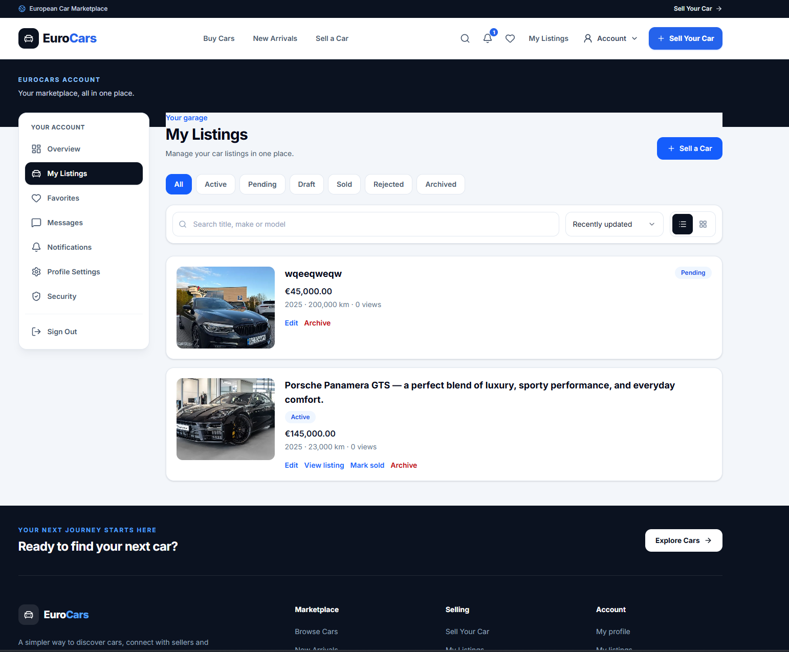

</details>

<details>
<summary>🛡️ Admin Dashboard</summary>

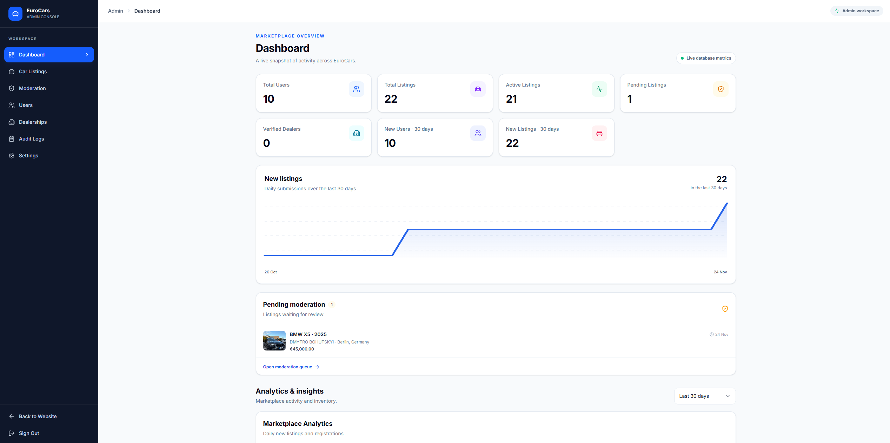
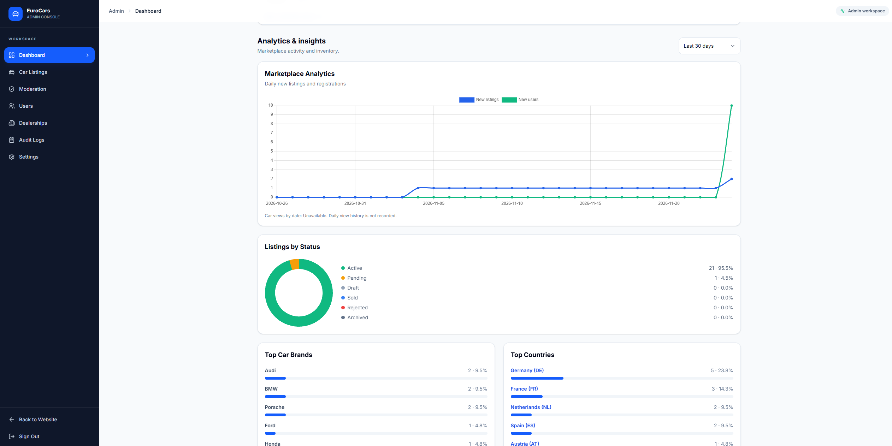
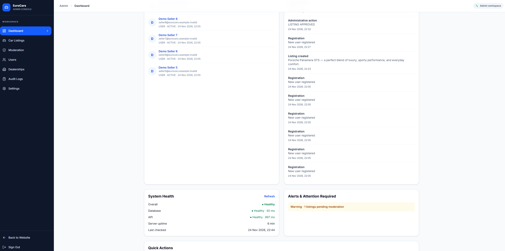
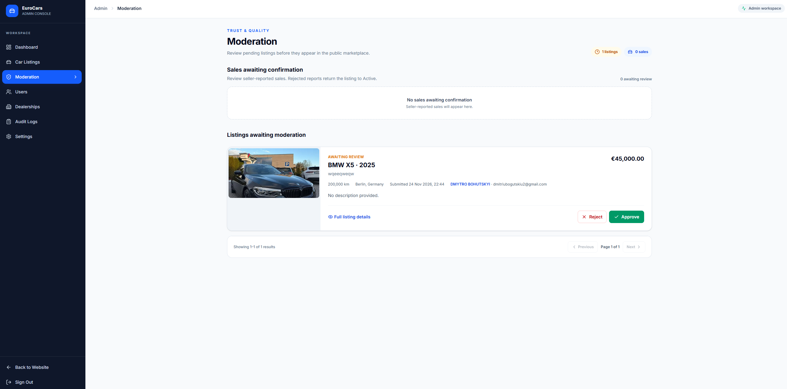

</details>


## 🚀 Getting Started

Clone the repository:

```bash
git clone https://github.com/scRelic/Eurocars.git
cd Eurocars
```

Navigate to the application directory containing package.json.

Install dependencies:

```bash
npm install
```

Configure environment variables using `.env.example`
and initialize the PostgreSQL database using the
provided SQL schema and migrations.

Start the development server:

```bash
npm run dev
```

Build for production:

```bash
npm run build
```

## 🗺️ Roadmap

- [ ] Real-time messaging
- [ ] Email verification
- [ ] Password recovery
- [ ] Advanced price analytics
- [ ] Vehicle comparison
- [ ] Saved searches
- [ ] Notifications
- [ ] Multilingual support

## ⚠️ Disclaimer

EuroCars is a portfolio and demonstration project.
Demo vehicle listings are for illustrative purposes
and do not represent actual offers for sale.

## 👨‍💻 Author

Developed by [scRelic](https://github.com/scRelic).

---

⭐ If you find this project interesting, consider giving it a star.
